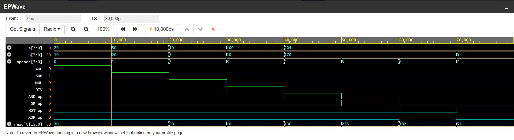

# RTL Design and Verification of a Digital Calculator using ALU

8-bit combinational ALU (digital calculator) written in SystemVerilog and verified with Cadence Xcelium on EDA Playground.
Project for the Employability Enhancement Course **SD0212 – RTL Design and Verification**, St. Joseph's College of Engineering (ECE, 2024–2028).

**Live EDA Playground project:** https://www.edaplayground.com/x/J7tj

## Features
- Two 8-bit operands (`A`, `B`) and a 4-bit `opcode`
- 16-bit `result` (holds the full 8x8 product)
- Operations: ADD, SUB, MUL, DIV, AND, OR, XOR, NOT
- One-hot operation indicators (`ADD`, `SUB`, `MUL`, `DIV`, `AND_op`, `OR_op`, `XOR_op`, `NOT_op`)
- Internal flags: zero, carry, borrow, divide-by-zero

## Opcode map
| Opcode | Operation | Description |
|--------|-----------|-------------|
| 0000 | ADD | A + B |
| 0001 | SUB | A − B |
| 0010 | MUL | A × B |
| 0011 | DIV | A / B |
| 0100 | AND | A & B |
| 0101 | OR  | A \| B |
| 0110 | XOR | A ^ B |
| 0111 | NOT | ~A |

## Repository layout
```
rtl/digital_calculator.sv      # design
tb/tb_digital_calculator.sv    # testbench (directed, 8 operations)
docs/                          # project report (.docx) and figures
```

## Run
- **EDA Playground:** open the link above, select *Cadence Xcelium*, tick *Open EPWave after run*.
- **Local (Xcelium):** `xrun -sv rtl/digital_calculator.sv tb/tb_digital_calculator.sv -access +rw`
- **Local (Icarus):** `iverilog -g2012 -o sim rtl/*.sv tb/*.sv && vvp sim`

## Results
All 8 directed tests pass (see Table 2.1 in `docs/` report).



## Team – Neural Nexus
Abinaya M, Dharshinipriya G S, Harshini S A, Mathi Sree R, Shwetha G
